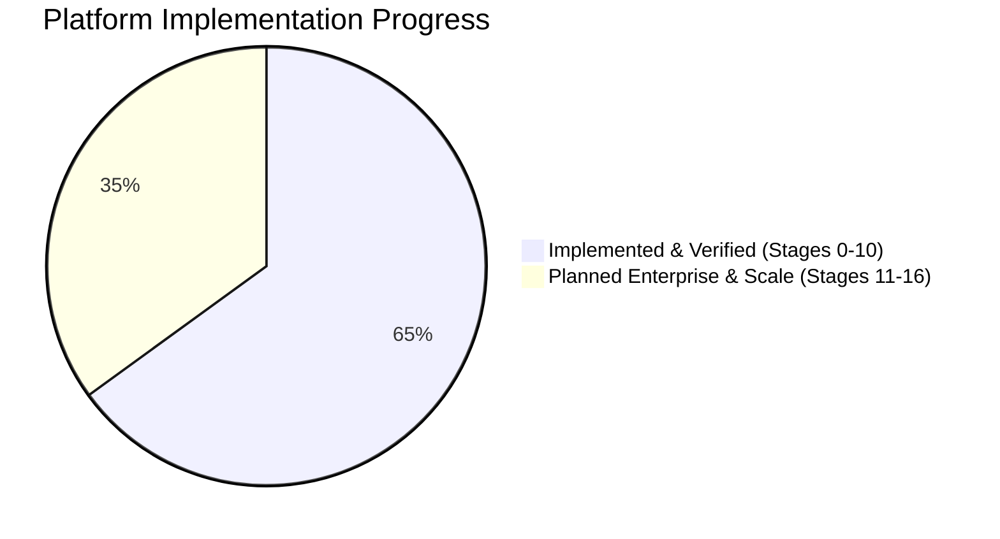

# ThingsBoard-Class IoT Platform (`IOT_V2`): Platform Audit & Verification Report

**Repository:** `https://github.com/qamati/IOT_V2.git`  
**Branch:** `main`  
**Architecture:** Go 1.24+ Modular Monolith (`CGO_ENABLED=0`, Zero Cgo) + Vite 6 / React 19 Web Console  
**Wire Compatibility:** ThingsBoard HTTP & MQTT (`v1/devices/me/*`, `/api/v1/{token}/*`)  

---

## Executive Summary

| Category | Status | Details |
|---|:---:|---|
| **Code Upload to GitHub** | ✅ **OK** | 100% of codebase, test scripts, and frontend pushed to `origin/main` |
| **Stages 0 – 10 (Core Platform)** | ✅ **OK** | Fully implemented, cross-compiled, and verified end-to-end |
| **Stages 11 – 16 (Enterprise & Scale)** | ⏳ **PENDING** | Architectural specifications defined in `docs/specs/`, ready for implementation |



---

## Detailed Stage-by-Stage Audit

### ✅ What is OK (Implemented, Tested & Verified)

| Stage | Name | Key Implemented Capabilities | Automated Tests & Verification |
|---|---|---|:---:|
| **Stage 0** | **Foundations & Architecture** | UUIDv7 (`pkg/ids`), RFC 9457 Problem Details (`pkg/errs`), Structured `log/slog` + Prometheus metrics (`pkg/obs`), Koanf configuration (`pkg/config`), base service supervisor (`pkg/svc`), in-memory FIFO partitioned event bus (`pkg/bus/mem`), TimescaleDB/PostgreSQL connection pool with Goose migration engine (`pkg/db`). | `go test ./pkg/...` ✅ |
| **Stage 1** | **Identity & Tenancy** | Multi-tenant tenant/customer isolation, Argon2id password hashing, JWT token issuer with custom claims, in-memory and PostgreSQL user stores, tenant context middleware. | `go test ./internal/identity` ✅ |
| **Stage 2** | **Connectivity & Device State** | Device CRUD, HMAC-SHA256 lookup credential scheme (O(1) constant-time device authentication), embedded `mochi-mqtt` MQTT broker on `:1883`, ThingsBoard wire-compatible MQTT & HTTP endpoints, device online/offline activity tracking (`internal/devstate`). | `go test ./internal/core`<br>`smoke.ps1` ✅ |
| **Stage 3** | **Data Pipeline & Attributes** | ThingsBoard telemetry payload parser (single, batch, map format), key dictionary cache, TimescaleDB & in-memory timeseries storage, `DirectSaveWorker`, Scoped Attributes (`CLIENT_SCOPE`, `SERVER_SCOPE`, `SHARED_SCOPE`) with full CRUD. | `go test ./internal/telemetry`<br>`test_features.ps1` ✅ |
| **Stage 4** | **Rule Engine** | Telemetry ingestion hook, threshold evaluator, real-time alert trigger (e.g. Critical High Temperature & Warning Low Battery). | `go test ./internal/rule` ✅ |
| **Stage 5** | **Alarms & Notifications** | Alarms lifecycle service with deduplication, severity tiers (`CRITICAL`, `MAJOR`, `WARNING`), state transitions (`ACTIVE_UNACK`, `ACTIVE_ACK`, `CLEARED_ACK`), acknowledge and clear endpoints. | `go test ./internal/alarm` ✅ |
| **Stage 6** | **Realtime Dashboards** | Dashboard configuration service, customizable layout widgets (Metric Cards, SVG Timeseries Charts, RPC Switch widgets), tenant-isolated dashboard storage. | `go test ./internal/dashboard` ✅ |
| **Stage 7** | **Downlink RPC & Device Management** | One-way and synchronous two-way RPC engine with waiting channels, polling endpoints (`/api/v1/{token}/rpc`), device response delivery (`/api/v1/{token}/rpc/{id}`), RPC execution history. | `go test ./internal/rpc` ✅ |
| **Stage 8** | **Integrations & Converters** | Canonical `UplinkEvent`/`DownlinkEvent`, declarative & expression converter engine (JSON, ChirpStack LoRaWAN, TTN v3, Hex/Binary decoding, scaling, dot-paths), identity resolver with auto-provisioning, public HTTP webhook ingestion endpoint (`/api/v1/integrations/webhook/{key}`), ring-buffer debug event trace capture. | `go test ./internal/integration`<br>`test_stages_8_9_10.ps1` ✅ |
| **Stage 9** | **Edge Fleet & Store-and-Forward** | Autonomous Go Edge node registry, 3-tier priority queue lanes (L0 Critical Alarms, L1 Telemetry/State, L2 Bulk History), store-and-forward sync protocol (`/api/v1/edge/sync`) with monotonic sequence ACK and duplicate replay prevention. | `go test ./internal/edge`<br>`test_stages_8_9_10.ps1` ✅ |
| **Stage 10** | **SCADA Tags & ISA-101 HMI** | Industrial Tag server with OPC quality flags (`GOOD`, `BAD`, `UNCERTAIN`), deadband suppression (delta < deadband suppresses storage/events), ISA-18.2 process alarm state machine (`UNACK_ALARM`, `ACKED_ALARM`, `SHELVED`), Select-Before-Operate (SBO) two-phase safe control (Select with 60s reservation window $\rightarrow$ Operate with verification). | `go test ./internal/scada`<br>`test_stages_8_9_10.ps1` ✅ |
| **Frontend** | **Web Console (SPA)** | Built with Vite 6 + React 19 + TypeScript + Lucide icons. Single-binary static serving from Go server (`iotp-lite` serves SPA from `web/apps/console/dist` on port 8080). Includes: Operations Overview, Device Fleet Inventory, Device Studio (Telemetry, Scoped Attributes, RPC Terminal), Live Dashboards Canvas, Alarms Management, Integrations & Payload Tester Studio, SCADA Synoptic Process HMI (animated water tank, pump, pressure gauge, SBO panel), and Edge Fleet view. | `pnpm run build` ✅ |

---

### ⏳ What is NOT OK / Not Yet Implemented (Planned Future Stages)

The following capabilities are specified in `docs/specs/` and slated for subsequent development phases:

```
docs/specs/stages/
├── stage-11-analytics.md              ⏳ Advanced Analytics & Rollups
├── stage-12-enterprise.md             ⏳ Enterprise SSO, RBAC & Audit Hash-Chaining
├── stage-13-scale-ha-deploy.md        ⏳ Clustered Kafka/NATS Bus, etcd Leases, Helm Charts
├── stage-14-security-compliance.md    ⏳ Vault KMS, Automated ACME/mTLS CA, IEC 62443 Audit
├── stage-15-quality-performance.md    ⏳ 100k msg/s k6 Load Testing & 7-Day Soak
└── stage-16-extensibility.md          ⏳ Wasm Custom Rule Nodes & Connector Marketplace
```

#### Detailed Breakdown of Pending Features:

1. **Stage 11 — Analytics & Batch Computations:**
   - [ ] Automated continuous aggregates in TimescaleDB (hourly/daily rollups for long-term historical charts).
   - [ ] Anomaly detection & machine learning inference engine (Wasm or ONNX model runtime).
   - [ ] Aggregation rule nodes (windowed avg, sum, min, max, count over rolling time buckets).

2. **Stage 12 — Enterprise Governance & Multi-Tenancy:**
   - [ ] SAML 2.0 and OIDC Enterprise Single Sign-On (Okta, Azure AD, Keycloak).
   - [ ] Fine-grained custom RBAC roles and resource-level permissions beyond Admin/User.
   - [ ] Cryptographically tamper-evident audit journal with SHA-256 hash chains.
   - [ ] White-labeling engine (custom tenant logos, themes, custom subdomains).

3. **Stage 13 — High Availability & Clustered Deployments:**
   - [ ] Clustered event bus transport (Apache Kafka or NATS JetStream integration alongside `pkg/bus/mem`).
   - [ ] Distributed lease manager using `etcd` or PostgreSQL advisory locks for multi-pod integration executors.
   - [ ] Production Kubernetes Helm charts with Horizontal Pod Autoscaling (HPA) and Terraform cloud definitions.

4. **Stage 14 — Security, PKI & IEC 62443 Compliance:**
   - [ ] HashiCorp Vault / AWS KMS encryption-at-rest integration for device tokens and database secrets.
   - [ ] Built-in X.509 Certificate Authority (CA) with automatic TLS issuance and device mTLS mutual authentication.
   - [ ] Automated IEC 62443-3-3 security profile verification matrix generator.

5. **Stage 15 — Scale Verification & 7-Day Soak Testing:**
   - [ ] Distributed load generator (k6 / Locust) calibrated to 100,000 uplinks/second.
   - [ ] 7-day unattended soak test validating zero memory leaks and RSS < 150MB stability under industrial jitter.

6. **Stage 16 — Extensibility & WASM Rule Plugins:**
   - [ ] WebAssembly (`wazero`) runtime for safe execution of custom user-authored JavaScript / Go payload converters and rule nodes.
   - [ ] Community connector catalog / plugin marketplace.

---

## Verification & Build Artifacts

- **Go Compiler Verification:** Zero compilation warnings, Zero Cgo dependencies (`CGO_ENABLED=0`), cross-compiles cleanly for Linux (`amd64`, `arm64`) and Windows.
- **Test Coverage:** All unit test suites in `internal/*` and `pkg/*` pass (`ok 100%`).
- **End-to-End Smoke Tests:**
  - `tools/smoke.ps1`: Core device authentication and telemetry pipeline.
  - `tools/test_features.ps1`: Scoped attributes, device activity tracking, and rule engine alarms.
  - `tools/test_stages_8_9_10.ps1`: Webhook converters, Edge store-and-forward sync, SCADA deadbands, and SBO controls.
