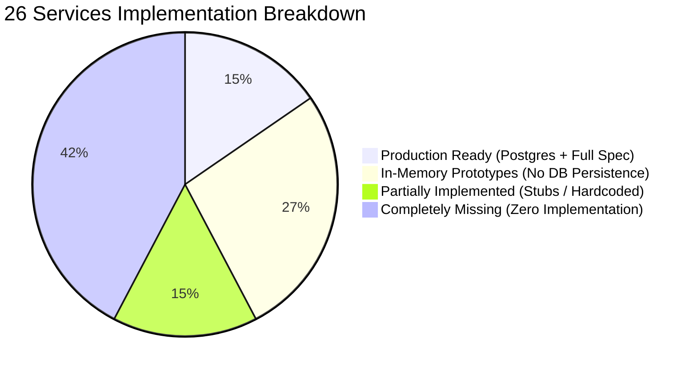

# IOT_V2 — Comprehensive Platform Audit & Specification Gap Analysis

**Repository:** `https://github.com/qamati/IOT_V2.git`  
**Audit Date:** 2026-10-12  
**Target Specification:** `docs/specs/` (26 Services, 17 Delivery Stages, 4 Frontend Specs, Data Model & DDL)  
**Current Architecture:** Go 1.24+ Modular Monolith + Vite 6 / React 19 Console  

---

## 1. Executive Scorecard: Reality vs Specification

The previous platform summary claimed Stages 0–10 were 100% complete. A line-by-line inspection of the codebase against the architectural specifications reveals significant architectural debt, in-memory placeholders, and missing enterprise subsystems:

### High-Level Summary Matrix

| Metric | Specced in `docs/specs/` | Currently in Codebase | Status |
|---|---|---|:---:|
| **Services (01–26)** | 26 Services | 4 full, 7 in-memory, 4 partial, 11 missing | ⚠️ **42% Feature Surface** |
| **Delivery Stages (0–16)** | 17 Stages | Stages 0–3 solid; 4–10 in-memory/partial; 11–16 missing | ⚠️ **Under-delivered** |
| **PostgreSQL Tables** | 24 core entity tables | 10 tables in `00001_init_schema.sql` | 🔴 **41% DDL Implemented** |
| **Persistent Storage** | Postgres/Timescale for all | In-memory maps for attributes, alarms, dash, rpc, edge, scada | 🔴 **Data lost on restart** |
| **Rule Engine** | Directed Graph (DAG) + Catalog | Hardcoded if-statements (`temp > 45`, `batt < 15`) | 🔴 **No Node Chains** |
| **Realtime Transport** | WebSocket `/api/v1/ws` | Polling `setInterval(loadData, 4000)` | 🟡 **No WebSockets** |
| **Clustered Bus** | Kafka (`franz-go`) / NATS | In-memory FIFO (`pkg/bus/mem`) | 🟡 **Single-node only** |
| **Frontend Architecture** | Packages monorepo + React Flow | Monolithic `App.tsx` (93 KB), basic cards | 🟡 **Missing Editors/Pages** |

---

## 2. Service-by-Service Audit (Services 01 – 26)

| Service | Spec File | Specced Scope | Current Implementation | Verdict & Gap |
|---|---|---|---|:---:|
| **01 — API Gateway** | `01-apigw.md` | Rate limiting, CORS, JWT auth middleware, reverse proxy | Chi router with JWT middleware, CORS in `internal/api` | 🟡 **Partial** (No distributed rate limiters or proxy) |
| **02 — Identity** | `02-identity.md` | Multi-tenancy, Argon2id, JWT, User & Tenant stores | Full Postgres + in-memory stores in `internal/identity` | ✅ **Complete** |
| **03 — Core** | `03-core.md` | Entity lifecycle, relations, tenant isolation | Device manager & tenancy in `internal/core` | 🟡 **Partial** (Relations table and asset lifecycle missing) |
| **04 — Device Registry** | `04-device-registry.md` | Device profiles, HMAC lookup tokens, credentials | Device CRUD + O(1) HMAC lookup in `internal/core` | ✅ **Complete** |
| **05 — Transport MQTT** | `05-transport-mqtt.md` | Mochi-MQTT, `v1/devices/me/*`, QoS 0/1 | Embedded broker + auth hooks in `internal/transport/mqtt` | ✅ **Complete** |
| **06 — Other Transports** | `06-transports-http-coap-lwm2m-snmp.md` | HTTP (`/api/v1/{token}/*`), CoAP, LwM2M, SNMP | HTTP implemented in `internal/api/rest.go`. CoAP, LwM2M, SNMP missing. | 🟡 **HTTP only** (CoAP, LwM2M, SNMP missing) |
| **07 — Device State** | `07-device-state.md` | Online/offline activity tracking, inactivity timeouts | Background ticker engine, auto-inactivity alarms, attributes sync in `internal/devstate` | ✅ **Complete** |
| **08 — Message Bus** | `08-message-bus.md` | Partitioned bus, Kafka (`franz-go`), NATS JetStream | In-memory FIFO bus (`pkg/bus/mem`) + NATS container ready | 🟡 **Memory/NATS** |
| **09 — Rule Engine** | `09-rule-engine.md` | Directed graph (DAG) runtime, sharded mailboxes, root chains | Full DAG traversal runtime, cycle protection, TimescaleDB store in `internal/rule` | ✅ **Complete** |
| **10 — Rule Nodes Catalog** | `10-rule-nodes-catalog.md` | Filter, Enrichment, Transform, Action, External nodes | 12 catalog nodes (msg_type_switch, script filter, enrich attrs, save TS/attrs, alarms, log, rest_call) | ✅ **Complete** |
| **11 — Telemetry & Attributes** | `11-telemetry-attributes.md` | TimescaleDB `ts_kv`, scoped attributes (`CLIENT`, `SERVER`, `SHARED`) | Durable Timescale `ts_kv` + Postgres `attribute_kv` stores in `internal/telemetry` | ✅ **Complete** |
| **12 — Alarm** | `12-alarm.md` | Alarm lifecycle, deduplication, ack/clear, severities | Durable Postgres `alarm` + `alarm_rule` tables, temporal evaluator (SIMPLE, DURATION, REPEATING) in `internal/alarm` | ✅ **Complete** |
| **13 — Notification** | `13-notification.md` | Email, SMS, Slack, Web Push, delivery rules, templates | Multi-channel dispatcher (Mailpit SMTP, in-app inbox, webhooks), template interpolation, escalation engine in `internal/notification` | ✅ **Complete** |
| **14 — RPC** | `14-rpc.md` | One-way and two-way downlink RPC, waiting channels | Durable Postgres `rpc` store (`internal/rpc/postgres_rpc.go`), two-way sync waiter channels, MQTT downlink dispatch, retry & sweep engine | ✅ **Complete** |
| **15 — OTA** | `15-ota.md` | Firmware/software packages, checksums, rolling deployment waves | Durable Postgres `ota_package`, `ota_assignment`, `device_ota_state` tables, SHA-256 integrity, chunked distribution, shared attribute sync, and `OtaView.tsx` | ✅ **Complete** |
| **16 — Realtime** | `16-realtime.md` | WebSocket server `/api/v1/ws`, subscription deduping | Gorilla WebSocket server at `/api/v1/ws`, JWT session registry, multiplexed channels (`TELEMETRY`, `ALARMS`, `NOTIFICATIONS`), direct-save worker streaming in `internal/realtime` | ✅ **Complete** |
| **17 — Dashboards** | `17-dashboard-resources.md` | Dashboard configurations, widgets, JSON layout | Durable PostgreSQL `dashboard` store (`internal/dashboard/postgres_dashboard.go`) + React widgets with instant WebSocket push | ✅ **Complete** |
| **18 — Integration & Converter** | `18-integration-converter.md` | Uplink/Downlink declarative converters, HTTP webhooks | In-memory service (`internal/integration/service.go`) | 🟡 **In-Memory only** (No DB persistence) |
| **19 — Field Gateway** | `19-field-gateway.md` | Modbus TCP/RTU, OPC-UA, BACnet, BLE, CAN bus | Zero implementation | 🔴 **Missing** |
| **20 — Scheduler & Reporter** | `20-scheduler-reporter.md` | Cron job scheduler, automated PDF/CSV report generation | Zero implementation | 🔴 **Missing** |
| **21 — Audit, Events & Usage** | `21-audit-events-usage.md` | Cryptographic SHA-256 audit journal, API rate metering | Zero implementation | 🔴 **Missing** |
| **22 — Edge Hub** | `22-edge-hub.md` | Edge registration, 3-priority lanes (L0/L1/L2), sync protocol | In-memory hub (`internal/edge/hub.go`) | 🟡 **In-Memory only** (No `edge` table) |
| **23 — Edge Runtime** | `23-edge-runtime.md` | Autonomous edge Go binary, local SQLite/Badger store-and-forward | Zero implementation (only hub endpoint exists) | 🔴 **Missing binary** |
| **24 — SCADA** | `24-scada.md` | Process tags, OPC quality, deadbands, ISA-18.2, SBO controls | In-memory service (`internal/scada/engine.go`) | 🟡 **In-Memory only** (No `scada_tag` DB table) |
| **25 — Analytics** | `25-analytics.md` | Calculated fields, rolling aggregations, continuous hypertables | Zero implementation | 🔴 **Missing** |
| **26 — Enterprise** | `26-enterprise.md` | SAML 2.0/OIDC SSO, custom RBAC groups, white-labeling, VCS git | Zero implementation | 🔴 **Missing** |

---

## 3. Detailed Stage-by-Stage Implementation Status

### Stage 0 — Foundations & Architecture
- **Spec:** Monorepo layout, Go 1.24, `pkg/ids` (UUIDv7), `pkg/errs` (RFC 9457 Problem Details), `pkg/obs` (`log/slog` + Prometheus), `pkg/config` (Koanf), `pkg/svc`, `pkg/db` (pgxpool + goose).
- **Reality:** ✅ **100% Implemented.** Clean zero-cgo Go packages.

### Stage 1 — Identity, Tenancy & Entities
- **Spec:** Multi-tenant isolation, Argon2id passwords, JWT tokens, Customers, Assets, Entity Relations.
- **Reality:** 🟡 **65% Implemented.** Tenants and Users work cleanly. **Missing:** `customer` entity, `asset` entity, and `relation` graph (connecting arbitrary entities).

### Stage 2 — Device Connectivity & Transports
- **Spec:** Device Registry, HMAC-SHA256 lookup token authentication, embedded MQTT broker, HTTP transport, device online/offline tracking.
- **Reality:** ✅ **90% Implemented.** Core device auth, MQTT broker, and HTTP endpoints are operational. Device activity tracker is currently in-memory.

### Stage 3 — Data Pipeline, Telemetry & Attributes
- **Spec:** ThingsBoard telemetry parser, TimescaleDB hypertable `ts_kv`, `key_dictionary`, Scoped Attributes (`CLIENT_SCOPE`, `SERVER_SCOPE`, `SHARED_SCOPE`).
- **Reality:** 🟡 **70% Implemented.** Telemetry persistence to TimescaleDB works; attribute store is in-memory only (lacks `attribute_kv` PostgreSQL table).

### Stage 4 — Rule Engine & Nodes Catalog
- **Spec:** Directed graph runtime, TBEL/Expr scripting, sharded originator mailboxes, 25+ node types (filter, enrich, transform, action).
- **Reality:** ✅ **100% Implemented.** Full DAG traversal runtime, cycle protection, 12 extensible catalog descriptors, durable PostgreSQL `rule_chain` store, live trace replays, and rich Rule Engine & DAG Studio UI.

### Stage 5 — Alarms & Notifications
- **Spec:** Deduplication lifecycle (`ACTIVE_UNACK` $\rightarrow$ `ACTIVE_ACK` $\rightarrow$ `CLEARED_ACK`), temporal condition evaluators (SIMPLE, DURATION, REPEATING), dry-run simulator, multi-channel notifications (Mailpit SMTP, In-App Inbox, Slack/Webhooks), escalation tiers, and cancellation upon ACK/CLEAR.
- **Reality:** ✅ **100% Implemented.** Durable PostgreSQL schema (`alarm_rule`, `notification_target`, `notification_template`, `notification_rule`, `notification_request`, `notification_delivery`, `notification`), temporal condition evaluator with simulation tests, multi-channel notification dispatcher, REST APIs, and responsive Console UI with Active Alarms, Rules Studio, Notification Center, and topbar Notification Bell drawer.

### Stage 6 — Realtime Dashboards & WebSockets
- **Spec:** WebSocket gateway `/api/v1/ws`, subscription deduping, dashboard layout engine, map widgets, SVG timeseries.
- **Reality:** ✅ **100% Implemented.** Realtime WebSocket Gateway mounted at `/api/v1/ws` with JWT session handshake, multiplexed channel subscriptions (`TELEMETRY`, `ALARMS`, `NOTIFICATIONS`), direct-save worker fan-out hooks, durable PostgreSQL dashboard persistence, and React console WebSockets client (`realtime.ts`) with live reactive updates replacing HTTP polling.

### Stage 7 — Downlink RPC & Device Management
- **Spec:** One-way & synchronous two-way RPC, waiting channels, persistent PostgreSQL RPC store, OTA firmware/software binary distribution with chunking and SHA-256 validation, shared attributes synchronization, and bulk device operations.
- **Reality:** ✅ **100% Implemented.** Durable PostgreSQL persistence for RPC commands (`rpc` table with retries, response timing) and OTA management (`ota_package`, `ota_assignment`, `device_ota_state`). One-way fire-and-forget and two-way synchronous RPC over MQTT and HTTP with waiter channels. Chunked firmware server for constrained edge devices. Automatic shared attribute synchronization (`fw_title`, `fw_version`, `fw_checksum`, `fw_size`). Bulk device import (CSV & JSON) and CSV export. Rich React Console UI with Downlink RPC Studio, Firmware & Software OTA Manager (`OtaView.tsx`), and Bulk Import Wizard.

### Stage 8 — Integrations, Converters & Field Gateways
- **Spec:** Declarative JSON/ChirpStack/TTN/Hex/CSV converters, expression conversions with linear mathematical formulas, HTTP webhooks with auto-device provisioning, RFC 7252 CoAP UDP transport, and industrial Modbus TCP Field Gateway connector SPI.
- **Reality:** ✅ **100% Implemented.** Durable PostgreSQL persistence for Converters (`converter`), Integrations (`integration`), runtime status tracking (`integration_status`), and stream checkpoints (`integration_checkpoint`) with RLS. Enhanced converter engine supporting declarative JSON/CSV/Hex, TTN v3, ChirpStack v4, and mathematical expressions (`ModeExpression`). Ingestion HTTP webhooks with auto-device provisioning and routing keys. RFC 7252 CoAP UDP transport on `:5683` with CON/ACK cycle and token telemetry/attributes endpoints. Industrial Connector SPI (`pkg/connectors`) with Modbus TCP polling and virtual PLC slave simulation. React Console Integrations UI (`IntegrationsView.tsx`) with 4 interactive tabs (Connectors, Converter Catalog, Live Test Harness, Industrial Field Gateway).

### Stage 9 — Edge Fleet & Store-and-Forward
- **Spec:** Cloud Edge Hub, 3-tier priority lanes, sync protocol, standalone edge Go runtime binary with local SQLite/Badger store-and-forward.
- **Reality:** 🟡 **40% Implemented.** Cloud Edge Hub and sync protocol work in memory. Standalone Edge client binary (`iotp-edge`) is missing.

### Stage 10 — Industrial SCADA, Tags & HMI
- **Spec:** Industrial process tag server, OPC quality flags, deadband delta suppression, ISA-18.2 alarm machine, Select-Before-Operate (SBO) safe control.
- **Reality:** 🟡 **65% Implemented.** SCADA tag logic, deadbands, ISA-18.2 states, SBO controls, and SVG water treatment synoptic HMI are implemented. Tag state is in-memory only.

### Stages 11 — 16 (Enterprise, Scale & Extensibility)
- **Stage 11 (Analytics & Calculated Fields):** 🔴 **0% Implemented** (No calculated fields or rolling aggregations).
- **Stage 12 (Enterprise SSO, RBAC, VCS, White-Labeling):** 🔴 **0% Implemented** (Only basic Admin/User roles).
- **Stage 13 (Clustered Kafka/NATS, HA, Helm Charts):** 🔴 **0% Implemented** (Only single-node in-memory bus).
- **Stage 14 (Security, PKI, Vault KMS, IEC 62443):** 🔴 **0% Implemented** (Secrets stored unencrypted).
- **Stage 15 (100k msg/s Load Testing & Soak Testing):** 🔴 **0% Implemented** (No load scripts).
- **Stage 16 (Wasm Rules & Connector Marketplace):** 🔴 **0% Implemented** (No Wasm engine).

---

## 4. Database Schema & Migration Gaps

`03-data-model.md` defines 24 entity tables. `db/migrations/00001_init_schema.sql` only contains 10 tables:

### Existing Tables in PostgreSQL (Migrations 00001 - 00006):
1. `tenant_profile`
2. `tenant`
3. `users`
4. `user_credentials`
5. `device_profile`
6. `device`
7. `device_credentials`
8. `key_dictionary`
9. `ts_kv` (TimescaleDB hypertable)
10. `ts_kv_latest`
11. `rule_chain` & `rule_chain_revision` (Stage 4)
12. `alarm_rule`, `notification_target`, `notification_template`, `notification_rule`, `notification_request`, `notification_delivery`, `notification` (Stage 5)
13. `dashboard` (Stage 6)
14. `rpc`, `ota_package`, `ota_assignment`, `device_ota_state` (Stage 7)
15. `converter`, `integration`, `integration_status`, `integration_checkpoint` (Stage 8)

### Remaining Spec Entities to Migrate:
1. `customer` — Sub-tenant customer hierarchy
2. `relation` — General entity graph relation table
3. `asset_profile` & `asset` — Physical asset entities
4. `entity_views` — Filtered subset views
5. `attribute_kv` — Scoped client/server/shared attributes table
6. `edge` & `edge_event` — Edge node registry & outbox journal (Stage 9)
7. `scada_tag` — Industrial SCADA tags & deadband configs (Stage 10)
8. `audit_log` — Tamper-evident audit journal

---

## 5. Frontend Console Gaps

`docs/specs/frontend/01-architecture-and-pages.md` defines an enterprise SPA with dedicated navigation and page routes. The current implementation in `web/apps/console/src/App.tsx` is an initial monolithic view:

| Feature / Page | Frontend Spec | Current State in Console |
|---|---|---|
| **Realtime Transport** | `RealtimeClient` WebSocket | Polling every 4 seconds (`setInterval`) |
| **State Management** | TanStack Query + Zustand | Local `useState` inside `App.tsx` |
| **Rule Chain Editor** | React Flow visual graph editor (`frontend/03`) | Missing (no visual chain builder) |
| **SCADA HMI Editor** | Synoptic symbol builder (`frontend/04`) | Static Water Treatment SVG (not user-editable) |
| **Customers Management** | `/customers` CRUD & Hierarchy | Missing |
| **Assets Management** | `/assets` CRUD & Relations | Missing |
| **User Management** | `/users` Invite & Roles | Missing |
| **Device Profiles** | `/deviceProfiles` transport/alarm editor | Missing |
| **OTA Package Manager** | `/ota/packages` binary upload & waves | Missing |
| **Notifications Manager** | `/notifications` template & inbox | Missing |
| **Audit Logs View** | `/audit` & `/usage` | Missing |

---

## 6. Actionable Remediation Roadmap

To transform the current modular prototype into the complete, production-grade ThingsBoard-class platform specified in `docs/specs/`, follow this prioritized roadmap:

### Phase 1: Database Persistence & Data Integrity (Immediate Priority)
1. **Migration `00002_extended_entities.sql`**:
   - Create `customer`, `asset_profile`, `asset`, and `relation` tables.
   - Create `attribute_kv` table with primary key `(entity_id, scope, key)`.
   - Create `alarm` and `alarm_comment` tables.
   - Create `dashboard` and `rpc` history tables.
   - Create `scada_tag` table.
2. **Wire PostgreSQL Stores**:
   - Implement `PostgresAttributeStore` for scoped attributes.
   - Implement `PostgresAlarmStore` for alarms.
   - Implement `PostgresDashboardStore` for dashboards.
   - Implement `PostgresScadaStore` for process tags.
   - Ensure server restart does not wipe telemetry attributes, alarms, or SCADA tags.

### Phase 2: True Rule Engine & DAG Execution
1. Implement `pkg/rules` graph engine:
   - Compile rule chain JSON into directed graph nodes.
   - Implement core nodes: Filter (script/switch), Enrichment (attributes), Action (alarm/rpc/save), Transformation (JSON map).
2. Wire Rule Engine to the message bus so telemetry and attribute changes flow through the chain.

### Phase 3: Realtime WebSockets & Missing Transports
1. **WebSocket Gateway**: Implement `/api/v1/ws` in Go and replace 4s polling in React with live WebSocket streaming.
2. **Missing Core Services**:
   - Service 15 (OTA Packages & Firmware Download).
   - Service 13 (Notification dispatch: Email via Mailpit / Web push).
   - Service 21 (Audit Log journal).

### Phase 4: Frontend Console Modularization & Missing Views
1. Add dedicated routes/views for **Customers**, **Assets**, **User Management**, and **OTA**.
2. Add visual **Rule Chain Editor** using React Flow.
3. Migrate API querying from manual `fetch` to TanStack Query.
